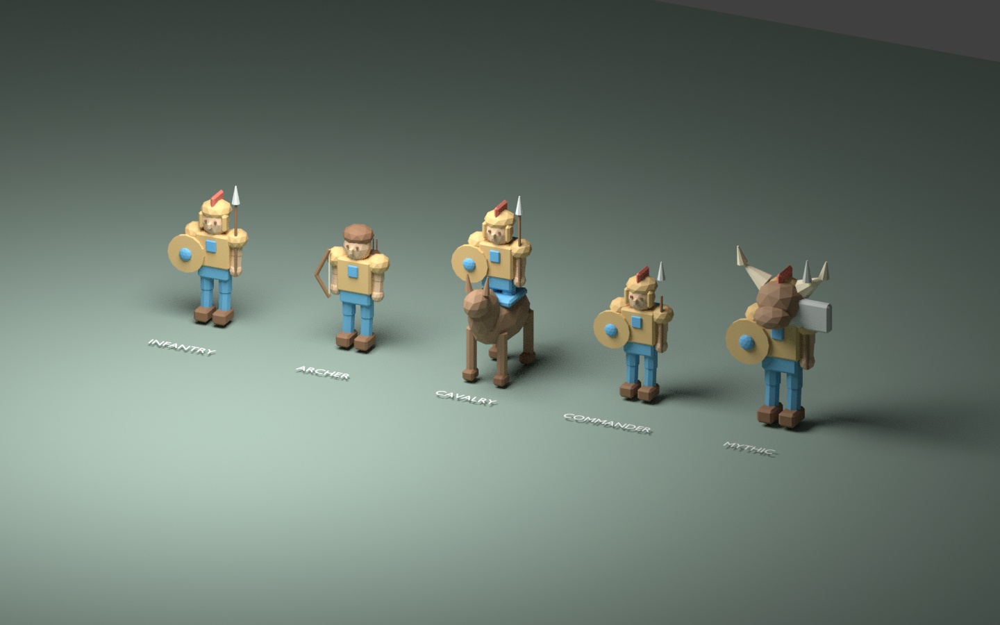
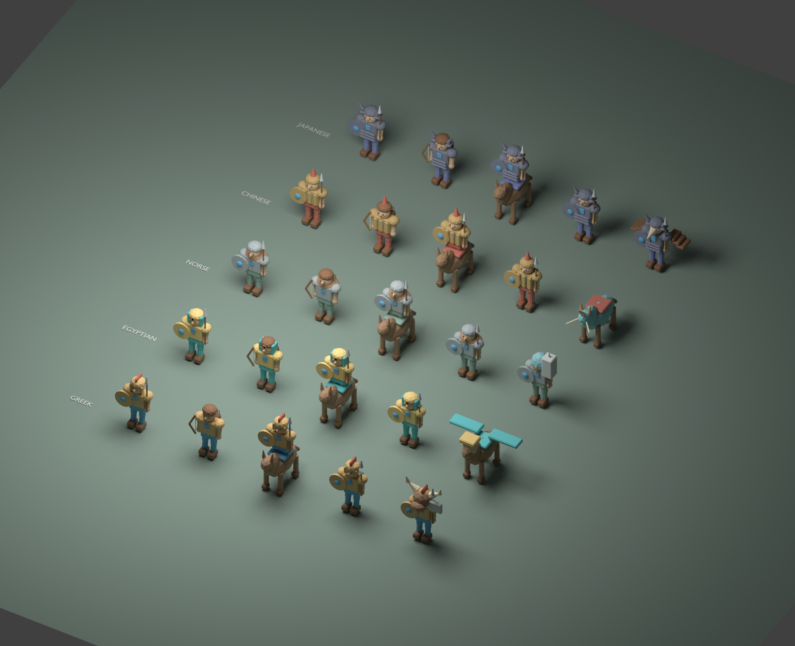

# Army and living city 0.17

This client/art release implements the five agreed work areas. Native Unity and
Windows verification remains pending: this cloud machine has Blender, but no
Unity Editor or Windows runtime. Asset previews below are Blender renders, not
screenshots of the game. These original low-poly assets establish a usable art
pipeline; they do not yet match the production finish of our reference games.

## 1. Native review and packaging

In Unity, open **Thrones of Myth → Art Review → Validate Imported Assets**.
It checks 44 FBXs (eight existing city/scenery models and 36 army models),
materials, scale, bone bindings and all eight animation takes per army model.
Windows packaging also runs this preflight and stops on errors.

Use **Capture Greek Asset Lineup** to review native rendering. In Play mode,
use **Capture Current Game View** and **Measure 300 Game Frames** while marching,
fighting and inspecting the city. Reports/images go to `work/native-art-review/`.
The frame sample measures the Editor Game View, not standalone performance.
Review missing/pink materials, facing/scale, lighting, overlapping UI, animations,
reduced motion and wide-map readability, then build and check the Windows player.
No native compilation, performance result or executable is claimed by this release.

## 2. Greek army and animation pipeline



Greek infantry, archers, cavalry, commander and Minotaur have weighted skeletons.
Each FBX contains Idle, March, Attack, Skill, Retreat, Victory, Gather and Hit.
Bipeds have 15 bones; mounted/quadruped rigs have 21. Armor is rigidly weighted
in jointed chunks, rather than a final organic character skin. Forearms, shins,
heads and mount legs animate. The server still owns movement and combat outcomes.

`tools/build_army_assets.py` generates the original models in Blender.
`tools/verify_army_assets.py` independently imports every exported file and checks
weights, bones, clip duration, moving bones and actual deformed mesh vertices.
The recorded validation covers 36 models and 288 deforming takes, with 52,688
triangles across the entire library. This proves exported animation data, not
Unity playback or production visual quality.

Unity imports Legacy clips. Runtime pose aliases tolerate FBX take-name prefixes.
An external orientation/scale parent prevents animated roots overwriting facing
or actor scale. Commander previews expose idle/march/attack/skill/retreat/victory.

## 3. Field formations and feedback

March composition chooses up to six mortal visual proxies across the troop types
actually deployed, a commander and up to two mythic proxies. Infantry take the
front, archers the rear and cavalry the flanks. Proxy counts are cosmetic; they
never change real army counts, damage, capacity or casualties.

Observed attacks, skills, health changes and completed stronghold victories drive
pose changes. Arrow release and impact cues have separate timing. A shared pool
caps dust/impact/skill particles at 48 objects. Six original synthesized PCM cues
cover footsteps, hooves, bow release, metal impact, divine casts and city ambience.
These are generated sounds, not recorded or professionally mastered effects.
Wide-map views hide extra proxies; reduced motion and effect/audio settings remain
available. Material-slot hit flashes preserve different armor and cloth colors.
Missing or unusable imported animation falls back to procedural actors.

## 4. Five civilizations and named commanders



Each culture has infantry, archer, cavalry, commander and mythic models, with
culture armor/cloth and separate team banners. Mythic silhouettes are Greek
Minotaur, Egyptian Sphinx, Norse Frost Giant, Chinese Qilin and Japanese Tengu.
All use the same eight-pose contract. Eleven named variants cover captain,
warden, scout, rune-seer, Atalanta, Mulan, Tomoe, Horus Champion, Heracles, Sigurd
and Wukong. Named hero appearance follows that hero's culture.
This release adds presentation, not new mythic skills or balance rules.

## 5. Living city

The City screen now defaults to an interactive rendered city. Click an institution
to inspect it and use the existing controls; orbit buttons change the view.
The district-list alternative stays available. Actual building levels determine
foundations and completed geometry; active construction alone adds scaffolds.
Construction, research, training and crafting progress come from real server jobs.
Two cosmetic guard patrols and optional ambience make the view less static.
Guards do not spend or create troops. The isolated city camera renders at 20 Hz.

## Update and reproduce

Army FBXs are stored using Git LFS. After pulling main, run `git lfs pull` if your
Git client has not downloaded them. A pointer text file is not a usable FBX.
Open the existing `client` project, allow imports to finish, run the review above,
then rebuild using the existing Windows playtest menu. Existing saves remain
compatible: protocol 13 and save schema 11 are unchanged; bundle version is 0.17.0.

Asset commands (Blender 4.3):

```sh
blender -b --python tools/build_army_assets.py
blender -b --python tools/verify_army_assets.py
python tools/build_audio_assets.py
```

See the committed army manifest, army validation and audio validation JSON in
`docs/art/` for reproducible asset evidence. Server regression tests remain part
of release validation. Native compiler/import/render checks must still run locally.
