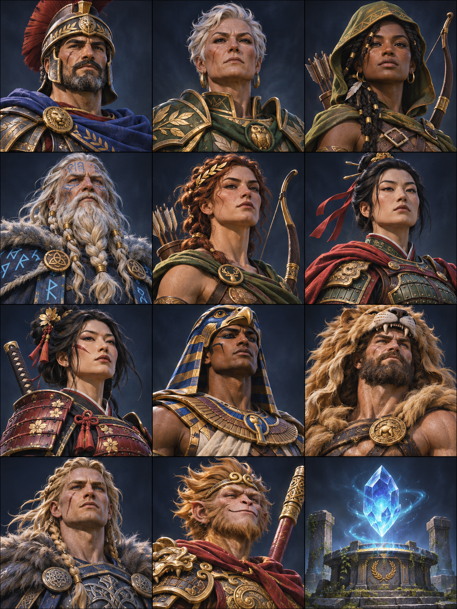

# Art and animation foundation · 0.7

The visual direction is **restored antiquity**: weathered stone, bronze and gold,
deep blue cloth, readable civilization silhouettes, and restrained divine light.
The five civilizations share one landscape and one interface language. These are
original assets and models; no artwork from Rise of Kingdoms, Call of Dragons,
or Age of Mythology is included.

## Painted artwork and the commander screen

Two original AI-generated PNGs live in `client/Assets/ThronesOfMyth/Resources/Art`:

- `CommanderAtlas.png`: eleven painted commanders and one unused Oracle vignette.
- `SanctuaryDawn.png`: a sanctuary landscape for kingdom entry and the Temple.

Atlas cells are three columns by four rows, read left to right from the top:

| Row | Left | Middle | Right |
| --- | --- | --- | --- |
| 1 | Frontier Captain | Sanctuary Warden | Pathfinder |
| 2 | Rune Seer | Atalanta | Hua Mulan |
| 3 | Tomoe Gozen | Champion of Horus | Heracles |
| 4 | Sigurd | Sun Wukong | Oracle vignette (reserved) |

`MythArtwork` maps stable commander IDs to cells, independently of server roster
order. Medallions are generated lazily with an alpha mask and cached; full cards
crop to their frame's aspect ratio without stretching faces. The originals stay
intact. The commander screen uses painted roster medallions, a larger portrait
card, colored rarity trim and corner ornaments, plus real stars and ascension.
Skill cards add active/passive emblems, locked states and five rank pips. A level
experience bar reflects actual commander XP. Existing progression and assignment
rules continue to apply.

`MythArtImporter` configures atlas readability, uncompressed color, clamp wrapping,
no mipmaps and a 2048 texture limit. **Thrones of Myth → Refresh Art Imports** can
repair existing local import settings. Images in Resources are bundled into the
Windows player; no image download or image-generation service is used at runtime.
The interface falls back to its procedural portrait if an asset is unavailable.

## The world

`WorldArtFactory` builds strategy-scale models from shared primitive meshes and
materials. They are a stylized modeling foundation, not final sculpted or rigged
production characters.

| Feature | Visual treatment |
| --- | --- |
| Greek city | Columned temple, stepped foundation and bronze pitched roof |
| Egyptian city | Stepped pyramid and gateway pylons |
| Norse city | Timber hall, broad gabled roof and entrance posts |
| Chinese city | Red walls and two broad roof tiers |
| Japanese city | Pale walls and three narrower dark roof tiers |
| Mortal formation | Three helmeted soldiers with separate legs, shields and weapon arms |
| Mythic escorts | Horned Minotaur, winged Sphinx, club-bearing Frost Giant, antlered Qilin, winged Tengu |
| Resources | Stacked logs, wheat, rock/gold clusters and aether crystals |
| Camps | Tents, timber defenses and fire; Minotaur/Giant camps use creature silhouettes |
| Sacred objectives | Open gate arches, shrines and a taller sanctuary ornament |
| Alliance territory | Banner and outlined beacon footprint instead of an opaque floor disk |
| Landscape | Procedural grass/earth variation, subdued borders, trees and scattered rocks |

Selection rings identify map targets. Visuals rebuild when ownership color,
civilization or escort count changes, rather than on every snapshot. Escort art
is capped at three models per march. Above orthographic zoom size 25, one mortal
proxy remains visible instead of all three. Counts in the interface remain the
actual server counts. These choices limit rendering cost; crowded-world profiling
and final model LODs remain future work.

## Animation and state

`WorldActorAnimation` affects artwork children, leaving navigation roots and
click targets intact. It reads real movement for march direction and walk cycles,
uses Gathering state for work motions, and displays banners and small camp fires.

The protocol-5 army snapshot adds two backward-compatible presentation fields:
`civilization` and `attackSequence`. Each actual normal attack increments the
sequence; idle time does not. Missing sequence fields in older schema-3 saves
read as zero. Sequence values survive subsequent saves. Combat damage, cadence,
rewards and progression are unchanged.

- A newer attack sequence drives a short weapon strike.
- A newer `skillCasts` value drives a short expanding skill ring and skill name.
- `shield > 0` shows a blue protective ring; it disappears when the shield ends.
- Observed health differences produce colored change captions. These are net
  snapshot health changes, not a fabricated per-hit combat log.
- The first observation establishes a baseline, so loading a city does not replay
  historical attacks or skill casts. Polling may coalesce several events into one
  visual response.

The Temple uses its existing short reveal and the painted portraits. Summon
results, prices, published odds, pity, and duplicate rewards are unchanged.

**Settings → Reduced motion** saves a local preference. It stops walking/weapon
poses, banner oscillation, fire pulsing, frame shimmer and expanding rings, and
shows summon results immediately. Movement and static gameplay indicators remain
visible. World labels can still be hidden independently.

## Build and review

Pull `main`, let Unity finish compiling/importing, then use the existing Windows
playtest build command. No scene regeneration or save reset is required. Build
version is 0.7.0; protocol remains 5 and save schema remains 3.

Server regression tests cover attack-event snapshots and old-save compatibility
alongside the existing gameplay and HTTP checks. C# source receives syntax checks
in the Linux workspace. **Unity compilation, shader rendering, animation playback,
texture import, and Windows performance still need native Editor verification.**

Suggested visual review in the next build:

1. Open kingdom entry, Commanders and Temple; inspect each portrait and all rarity
   colors. Try an invocation and check that the outcome matches its history entry.
2. March, gather and attack; watch direction, legs, weapon movement, skills, shield
   indicators, and net health captions. Zoom out to inspect formation simplification.
3. Review all five civilization cities and mythic silhouettes using separate saved
   profiles, then compare resource types, gates, camps and the sanctuary.
4. Select objects and change alliance ownership; verify selection and team colors.
5. Enable reduced motion, close/reopen Settings, and restart the player to check
   persistence. Inspect portrait and Temple layouts at 85% and 115% interface size.

The next art milestones are authored low-poly meshes with proper silhouettes and
UVs, rigged creature/commander animation, ability-specific VFX, a dedicated city
scene, and audio. The current modular artwork layer is intended to support those
replacements without changing server rules.
