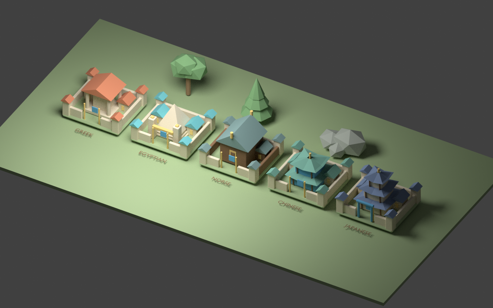

# Kingdom chronicle and map art · 0.16

This release adds scheduled kingdom openings, then a first original stylized
map/city art pass inspired by the readability of large mobile strategy games.
It does not reproduce their characters, models, UI artwork or branding.

## Kingdom chronicle

| Stage | Earliest time from kingdom founding | Kingdom preparation | Reward eligibility score |
| --- | --- | --- | --- |
| Embers Become Cities | Immediately | Gather 400 resources and train 10 mortal troops | 1 |
| The Divine Gates Awaken | 10 minutes | Complete prior stage; defeat four camps; have a Citadel 2 city | 5 |
| The Road to the First Throne | 30 minutes | Complete prior stage; defeat two strongholds; occupy both gates | 10 |
| An Oath Holds the Throne | 35 minutes | Complete prior stage; one alliance holds the sanctuary continuously for five minutes | 15 |

This is explicitly the **local playtest schedule**. It is short enough to review
in one session, not a balanced production kingdom season. Gates and sanctuary
need both the elapsed time and preparation conditions. Opening is permanent;
losing a preparation objective afterward does not reseal the stage.

Starting shrines stay available to the opening chapter campaign. Divine Gates
cannot be captured, rallied, garrisoned or used for access while sealed. The
sanctuary likewise cannot be captured or rallied before its stage opens. Army,
scout and rally routes still require actual gate ownership after opening.
Return-home corridors remain usable for stranded troops.

Opening both gates is a kingdom-wide stage; the gates can initially belong to
different alliances. Entering the inner province still requires one alliance to
own both, creating a normal territory objective. A sanctuary ownership change or
loss resets its hold timer. The hold uses persisted calendar time and can finish
while the local server is closed if ownership is unchanged. This does not add
ruler/governance powers or a KvK season.

## Contributions and rewards

Server-observed gathering, training, camp/stronghold victories, development,
scouting and assistance build personal contribution scores:

- One point per 100 resources gathered or five mortal troops trained.
- Two per camp victory, five per stronghold victory.
- One per completed development project, survey or successful allied assist.

Shared camp and stronghold wins count once toward kingdom goals, while each
qualifying contributor earns personal credit. Score is cumulative within this
kingdom. Each stage records eligible city IDs when it completes; later arrivals
or later contributions cannot claim earlier rewards. Eligible cities claim once,
with the claim ledger retained across restart and alliance changes.

Stage rewards are, in order: (1) 100 wood, 100 food, 50 gold, 50 stone;
(2) 150 wood, 150 food, 100 gold, 100 stone; (3) 150 gold, 150 food, 150 stone,
15 aether and one sigil; (4) 250 gold, 200 wood, 200 food, 30 aether and three
sigils. Reward previews and the score threshold appear in the chronicle.

Open **Kingdom** from activity navigation, click the minimap's **Kingdom
Chronicle** header, or inspect a sealed landmark. The view shows preparation
bars, timers, eligibility and claim controls. Unknown landmarks keep their
public seal state without exposing hidden ownership.

## Original art pass

Eight original FBX meshes replace city/scenery placeholders:

- Greek city with terracotta temple roof, columns and walled courtyard.
- Egyptian city with pyramid, pylons and turquoise roof accents.
- Norse longhouse city with timber, steep slate roofs and finials.
- Chinese city with jade eaves and stacked pavilion silhouette.
- Japanese city with layered indigo roofs and a small torii gate.
- Oak, pine and border-rock meshes for clustered landscape dressing.

The map now uses warmer regional grass/earth colors, painted arterial paths,
clustered forests, rocky province edges with corridor clearings, warm soft
lighting and lighter exploration mist. Shared material palettes preserve team
banner colors. Static scenery batches by material; readable model imports enable
runtime batching. Gameplay movement remains the province/portal graph; decorative
forests are not a terrain navigation mesh.

The interface adds embossed panel gradients, subtle texture grain, fine gold
trim, blue primary actions, navigation medallions and higher-contrast world name
plates. Existing portraits, loading paintings and articulated troop rigs remain.
This is a first art-direction pass; troops/commanders still need authored meshes,
skinned animation, final VFX and native performance/art review.

The image is a Blender asset lineup, **not a screenshot of Unity gameplay**.
`tools/build_stylized_assets.py` generates the meshes and preview. Run it with
`blender -b --python tools/build_stylized_assets.py`. The verification script
round-trips all eight FBXs and writes
[mesh validation](art/asset-validation-0.16.json). Windows players need neither
Blender nor the generation scripts: the package includes imported game assets.

## Saves and verification

Build 0.16.0 uses protocol 13 and schema 11. Schemas 1–10 retain versioned archives.
Existing owned gates and sanctuary access are preserved as legacy openings;
those inherited stages grant no retroactive rewards. Future stages remain
playable. Legacy kingdom age uses saved simulation age, and new hold timing starts
when ownership is observed. Existing resources, activity, commanders and territory
remain saved.

The milestone suite checks fresh-world seals, timer/preparation requirements,
a legal fresh-city preparation playthrough, sanctuary hold resets, eligibility,
HTTP privacy and legacy preservation. Earlier combat/economy suites explicitly
use opened-stage fixtures to isolate their original mechanics.

All eight FBX assets passed Blender round-trip geometry/material checks and the
asset preview was rendered and inspected. C#/PowerShell source syntax, partial
methods, script metadata and server module packaging are checked in the cloud.
Unity compilation, FBX import/material appearance, live terrain, fog, shadows,
input, frame time and the Windows executable still need local validation.

Pull main, stop older servers, and rebuild **Thrones of Myth → Build Windows
Playtest**. Open **Kingdom** to inspect the schedule. Existing scenes load the new
runtime art automatically; a new city/world is best for reviewing the full early
opening flow without legacy access.
